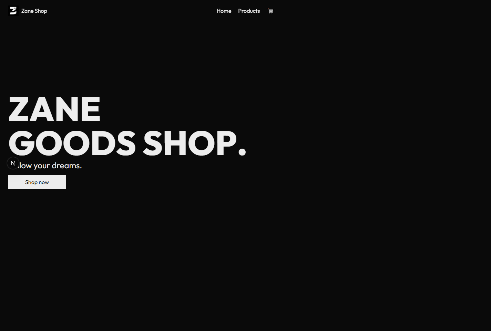
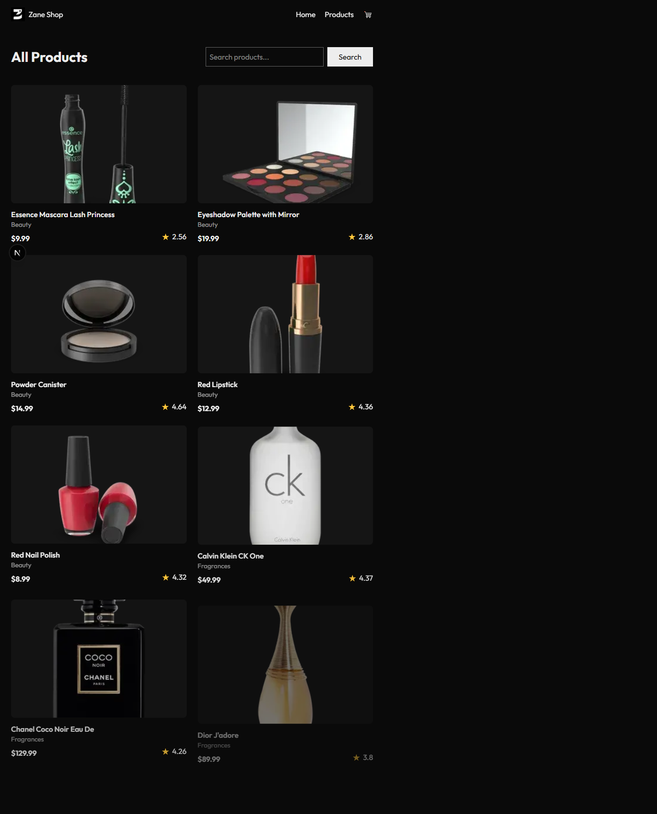
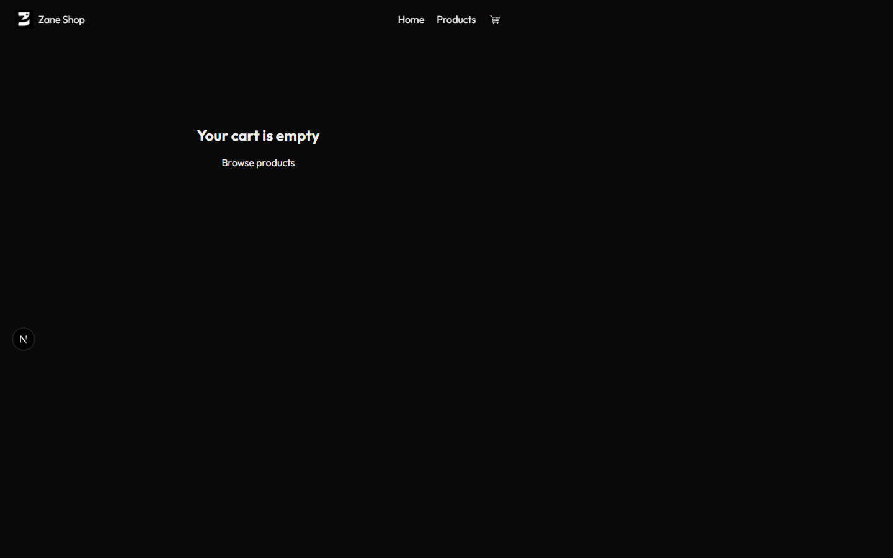

# Zane Shop

A modern, responsive goods storefront built with Next.js and React. Zane Shop showcases products from the DummyJSON catalog, lets customers search and browse products, and provides a persistent shopping cart.

**Live site:** https://zane-shop.vercel.app

## Screenshots

### Home



### Products



### Shopping cart



## Features

- Animated home page with a bold storefront introduction
- Product catalog loaded from the DummyJSON API
- Product search and paginated browsing
- Responsive product and detail layouts
- Individual product pages with ratings, descriptions, pricing, and stock availability
- Add-to-cart notifications and live cart item counts
- Persistent cart state using browser `localStorage`
- Quantity controls, item removal, and cart clearing
- Order total calculation and a successful checkout confirmation
- GSAP page and product-grid animations
- SEO metadata, Open Graph images, JSON-LD product data, robots, and sitemap support
- Accessible navigation and responsive Tailwind CSS styling

## Tech stack

- [Next.js 16](https://nextjs.org/) - App Router framework
- [React 19](https://react.dev/) - UI components
- [Tailwind CSS 4](https://tailwindcss.com/) - Styling
- [GSAP](https://gsap.com/) - Animations
- [DummyJSON](https://dummyjson.com/) - Product catalog API
- [Vercel](https://vercel.com/) - Hosting and deployment

## Getting started

### Prerequisites

- Node.js 18.18 or newer
- npm

### Installation

```bash
git clone https://github.com/jawadcreative/zane-shop.git
cd zane-shop
npm install
npm run dev
```

Open http://localhost:3000 in your browser.

## Available scripts

| Command | Description |
| --- | --- |
| `npm run dev` | Start the local development server |
| `npm run build` | Create an optimized production build |
| `npm run start` | Start the production server |
| `npm run lint` | Run ESLint |

## Production build

```bash
npm run build
npm run start
```

## Project structure

```text
app/
  page.js                 # Home page
  products/               # Catalog and product detail routes
  cart/                   # Shopping cart
  checkout/               # Checkout confirmation
  context/CartContext.js  # Cart state and localStorage persistence
components/               # Shared navigation, search, buttons, and animations
public/
  images/                 # Brand assets
  screenshots/            # README screenshots
```

## API

Product data is fetched at runtime from DummyJSON:

- Catalog: `https://dummyjson.com/products`
- Search: `https://dummyjson.com/products/search?q=<query>`
- Product details: `https://dummyjson.com/products/<id>`

No API key or environment variable is required.

## What I Learned
I learned a lot of new things in Next.js. I had heard about its automatic loading and error handling and custom "not found" pages, but this was the first time I actually implemented them, and it was amazing. I also learned how to fetch APIs on the server side, and how to add an item to a cart. One especially valuable thing was seeing how SEO works in practice. I had used Context before, but this time I understood it much better. 